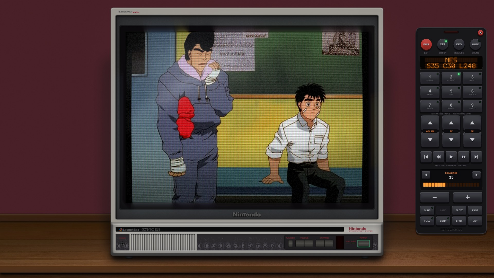
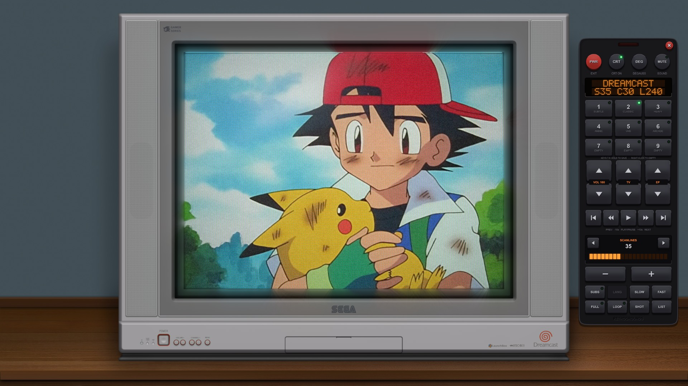
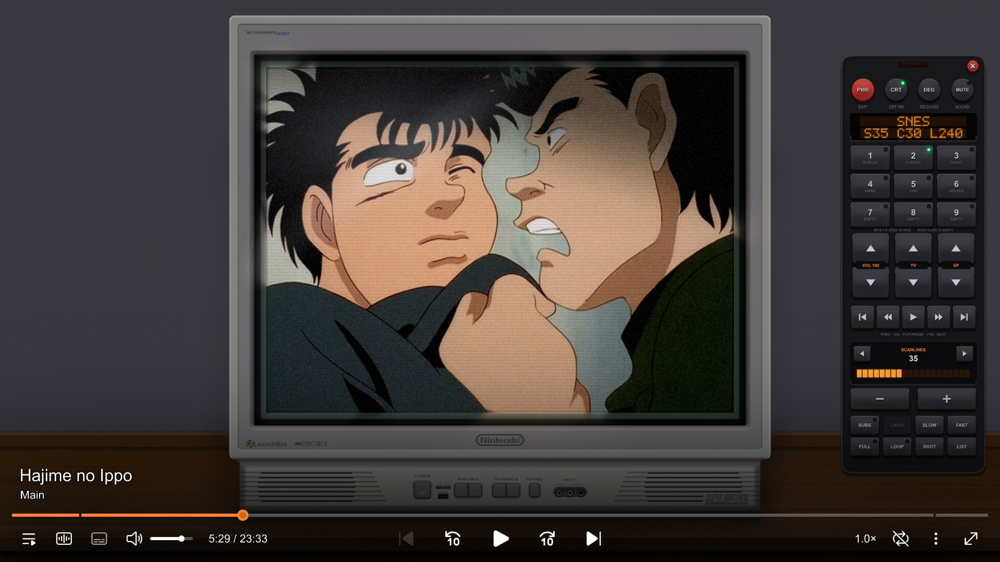
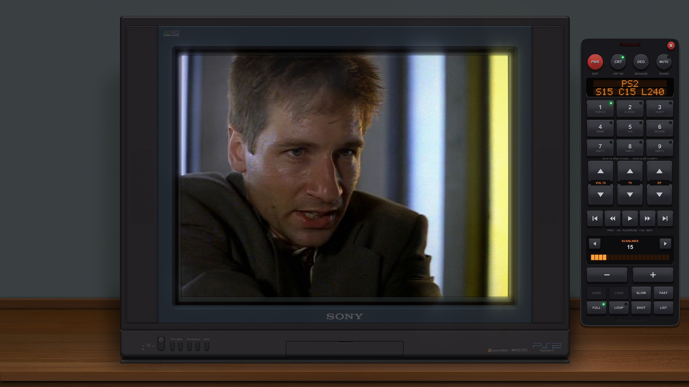
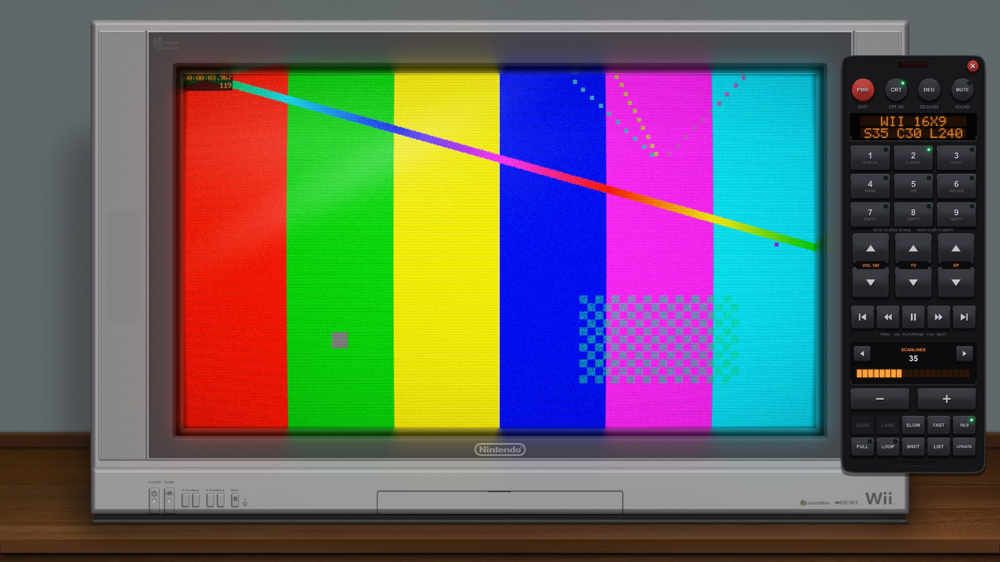
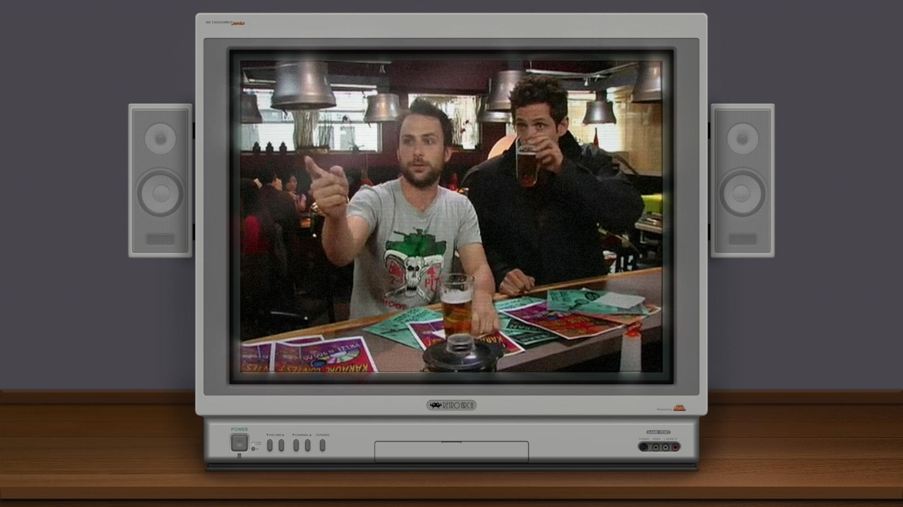
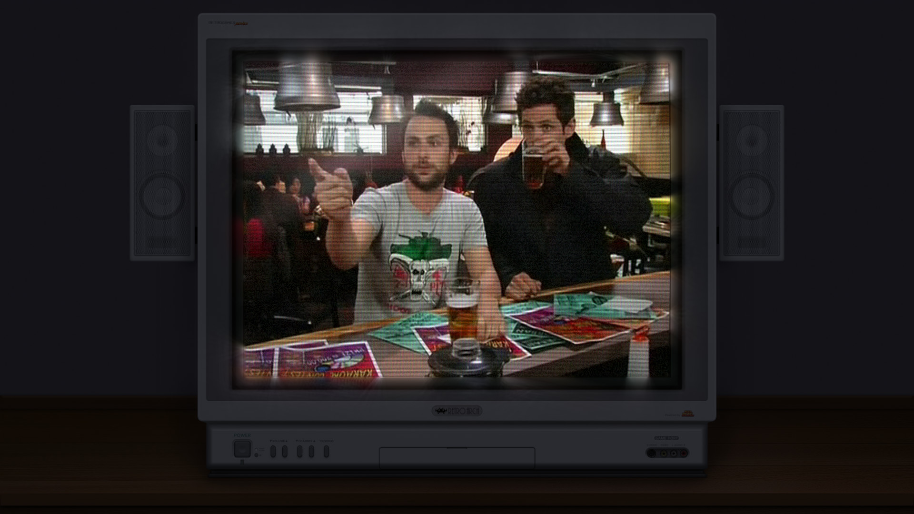
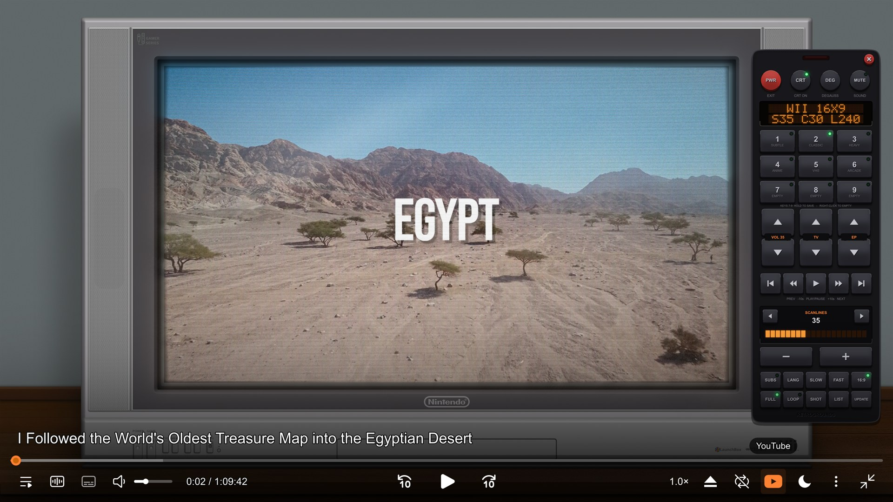
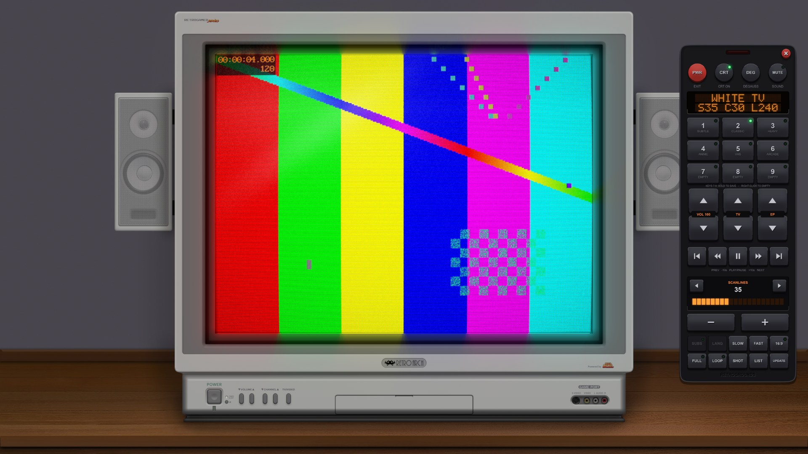

# CRT-mpv

Watch any video on a real retro CRT television: curved glass, scanlines, phosphor mask, analog noise,
NTSC signal bleed and a glass reflection, inside a full TV set (54 of them: Nintendo, Sega, NEC, Sony and SNK sets,
widescreen 16:9 TVs and 1970s wood-cabinet consoles), all rendered at your screen's **full resolution** in
[mpv](https://mpv.io). It comes with VLC-style hover controls, a clickable, hand-drawn **TV remote** on the screen
that controls everything, and it **updates itself** from GitHub when a new version comes out.


*(The picture inside the TV is ffmpeg's `testsrc2` test pattern, with the on-screen remote open on the right; the TV artwork is by Soqueroeu; see [Credits](#credits).)*

> **Status:** developed and tested on **Windows 11**. The macOS and Linux installers are included and the
> Linux install steps have been tested, but playback on macOS and Linux has **not** been tested yet.
> Reports and fixes are welcome.

[](https://ko-fi.com/retrogrounds)
CRT-mpv is free. If you enjoy it, you can support its development on [Ko-fi](https://ko-fi.com/retrogrounds).

## Screenshots

| | |
|:---:|:---:|
|  |  |
| Nintendo NES TV (Hajime no Ippo) | Sega Dreamcast TV (Pokémon: Indigo League) |



*Nintendo SNES TV with the hover controls (title, seek bar, previous/next, play, skip, volume, audio, subtitles, speed, fullscreen) and the on-screen remote showing.*



*Sony PS2 TV (The X-Files) with the Subtle preset.*



*Widescreen Wii 16:9 TV (ffmpeg's `testsrc2` test pattern). The remote's **16:9** key is lit: the TV keys now step through the widescreen TVs only.*

| | |
|:---:|:---:|
|  |  |
| Night mode off | [Night mode](#night-mode) on |

*The same frame on the White TV (It's Always Sunny in Philadelphia). With night mode on, the TV and the room around the screen go dark and the screen's glow on the bezel gets a little stronger; the picture itself is unchanged.*



*A YouTube video on the widescreen Wii 16:9 TV, opened with the [YouTube](#youtube) button (highlighted under the pointer on the hover bar), with the on-screen remote open.*

The video frames in these screenshots belong to their respective rights holders and are shown only to demonstrate the effect. The TV artwork is by Soqueroeu (see [Credits](#credits)).

## Contents
- [Screenshots](#screenshots)
- [What is new and custom](#what-is-new-and-custom)
- [Why this exists (and why it isn't a VLC plugin)](#why-this-exists-and-why-it-isnt-a-vlc-plugin)
- [Install](#install): [Windows](#windows) · [macOS](#macos) · [Linux](#linux) · [Uninstall](#uninstall)
- [Using it](#using-it), the [on-screen remote](#on-screen-remote), [opening videos](#opening-videos), [YouTube](#youtube), [about](#about) and [updates](#updates)
- [Customising](#customising)
- [How it works](#how-it-works)
- [Performance](#performance)
- [Troubleshooting](#troubleshooting)
- [Credits](#credits)
- [Licenses](#licenses)

---

## What is new and custom

CRT-mpv started from a VLC plugin, but almost everything you see here is new code written for this project.

**The picture**
- **True full-resolution CRT.** The TV is composited at your desktop's resolution (1080p, 1440p, 4K, whatever you have) and the CRT effect runs as a GPU shader on the *final* scaled image. A 640x480 episode gets razor-sharp scanlines and a crisp TV, not a stretched, blurry copy. This is the problem no VLC filter can solve (see [Why this exists](#why-this-exists-and-why-it-isnt-a-vlc-plugin)).
- **The effect stays inside the glass.** The shader is told where each TV's screen is, so curvature, scanlines, phosphor mask, glow and vignette bend and shade only the picture. The TV set around it stays sharp and flat.
- **NTSC signal simulation.** Four modes: clean, S-Video, composite (colour bleed, rainbow fringes, crawling dot pattern) and RF. The Anime preset uses S-Video, VHS uses composite.
- **Analog noise** that moves with the video: grain, colour noise, a rolling interference band and per-line jitter. A paused picture holds still.
- **Glass reflection:** a soft window light, a diagonal streak and a glint on the top edge, stronger on more curved screens.
- **Bezel glow:** light from the picture spills onto the TV around the screen. Close to the edge the bezel shows a soft mirrored reflection of the picture, further out it fades into a glow in the picture's colours.
- **A TV that behaves like one.** It warms up out of a thin white line when the player starts, collapses to a line and then a dot when you press PWR, and changing TV or episode cuts through a burst of static.
- **DEGAUSS button:** a thunk and a fading mains hum (made on the fly, no sound files) while the picture wobbles and colour blotches swirl across the glass.
- **VHS tracking:** knock it off and a band of torn, noisy lines rolls through the picture, the bottom lines tear sideways and the image judders. Tune it back to centre for a clean picture, like the knob on a VCR.
- **Contrast and colour** controls, and a **pixel-font MUTE display** drawn by the shader itself, so it curves and glows with the picture like an old TV menu.
- **54 TVs** that you can switch with one key: console-themed sets for Nintendo, Sega, NEC, SNK, Sony, Atari and 3DO, generic sets, **widescreen 16:9 TVs**, and 1970s vintage wood-cabinet consoles. A **16:9** key on the remote (or `w`) switches between the widescreen and the 4:3 TVs, and there is a one-line way to add your own.
- **Subtitles live inside the TV screen** and go through the CRT shader with the picture, so they get the same curvature, scanlines and glow.

**The controls**
- **An on-screen TV remote**, drawn from scratch as vector graphics: moulded, embossed keys that sink when pressed, status LEDs, an orange dot-matrix display, a red IR window that flashes on every press, a DEGAUSS key, and an adjustment panel with a level meter (VHS tracking included). It scales with the window, needs no image files and opens at every start.
- **Presets:** six locked factory looks (Subtle, Classic, Heavy, Anime, VHS, Arcade) and **three programmable slots** (hold a key to save every setting of the look into it; the TV is yours to pick separately).
- **Everything is remembered**: TV, look, presets, volume, mute and loop come back on the next start, saved on every change and on exit.
- **VLC-style hover bar** (previous/next, seek, volume, audio and subtitle tracks, playlist, fullscreen) with a seek that previews while you drag and lands on the exact time when you let go.
- **Folder playlist:** open one episode and the rest of the folder is queued.
- **Open videos from the player:** started on its own, CRT-mpv switches the TV on with no signal (a screen of TV static), and a library button (a folder) on the hover bar opens your favourite and recent folders, with a folder browser.
- **YouTube on the TV:** a button on the hover bar opens a panel to paste a YouTube link, and the video plays on the TV like any other.
- **Night mode:** a moon button on the hover bar turns the room lights off: the TV and the room around the screen fade dark and the screen's glow on the TV shows a little more.
- **One look for every menu:** the playlist, audio tracks, subtitles, chapters, playback speed, audio output and the update prompt use the same dark panels as the library, with mouse, wheel and keyboard control and a draggable scrollbar.
- **About window:** an "i" button on the hover bar shows the version, a thank-you note and links to Retrogrounds and Ko-fi.
- **Updates itself:** when a new version is released, the player offers it at start-up (or when you press **UPDATE** on the remote), downloads it from GitHub, installs it with your settings kept and starts again on the same episode, at the same spot.

**The engineering**
- **Light on the CPU:** the TV is composited in planar yuv420 pinned to BT.709 rather than RGBA, which is about 3x cheaper (see [Performance](#performance)).
- **No native code.** One GLSL shader, a few Lua scripts and config. Nothing to compile and no admin rights; it lives in one folder, isolated from any mpv or VLC setup you already have.
- **Windows integration:** a launcher with its own icon, an *Open with* menu entry, and the icon on the player's window and taskbar button.
- **Safe installs** on Windows, macOS and Linux: every download is pinned to an exact version and checked against a SHA-256 checksum.

---

## Why this exists (and why it isn't a VLC plugin)

This project started as an attempt to get the excellent
[**VLC-CRT-emulator-plugin**](https://github.com/itsdunintime104/VLC-CRT-emulator-plugin) running on Windows.
That plugin (by itsdunintime104, built on [Jules Lazaro's original](https://github.com/julescools/VLC-CRT-emulator-plugin))
is a native C filter inside VLC: it processes each decoded video frame on the CPU and can draw a TV picture around it.
It looks great **when the video is high resolution**: the README screenshots are sharp.

On Windows, with a real library of mostly standard-definition 4:3 episodes (e.g. 640×480), we ran into
problems that are built into how VLC filters work. Each one is fixed here by moving to a different design.

| # | Problem with the VLC plugin | Why it happens | How CRT-mpv fixes it |
|---|---|---|---|
| 1 | **The TV picture and scanlines were blurry** on standard-definition video. | A VLC video filter only ever sees the decoded frame at the video's own size (here 640×480), and VLC **forces the filter's output back to that size**. The log shows `swscale: 1920x1440 -> 640x480` when we tried upscaling inside the filter. So the TV, scanlines and curvature are drawn into a 640×480 frame and then stretched to your monitor. No filter setting can fix this. | The TV is composited on a canvas the size of **your desktop** (for example 2560×1440) and the CRT effect is a **GPU shader that runs at display resolution after the video is scaled**. Scanlines stay fine and the TV stays sharp whatever the source resolution. |
| 2 | **Ragged screen edges / aliasing.** | The plugin shrinks the video into the TV screen on the CPU with nearest-neighbour sampling in YUV. | The video is scaled into the TV with ffmpeg's Lanczos scaler, and the final image is scaled by mpv's GPU scaler (`ewa_lanczossharp`). |
| 3 | **Refused 10-bit and hardware-decoded video.** | The filter only accepts 8-bit planar YUV (`Unsupported chroma (DX10), need planar YUV`). VLC then inserts format converters (GPU→CPU copy, 10→8-bit), adding CPU cost and losing precision. | mpv's shader pipeline accepts any pixel format natively. |
| 4 | **Native code that has to be compiled for every platform.** | A VLC plugin is a C library that must match VLC's version, architecture and C runtime, built with the VLC SDK headers and a compiler (MSVC on Windows). On Windows we cross-compiled it and hit a crash on launch (heap corruption: the plugin `free()`d a string that VLC had allocated with a *different C runtime*). | **No native code at all**: just a GLSL shader, a Lua script and config. Nothing to compile, no ABI to match. |
| 5 | **Fragile, admin-only install.** | Plugins live in `C:\Program Files\VideoLAN\VLC\plugins`, which needs admin rights; VLC must have its plugin cache (`plugins.dat`) regenerated, and if that is done with a *relative* path it silently produces an empty cache and VLC refuses to start ("no plugins were found"). The enabled module name in `vlcrc` must also match exactly (an old `crtscanline` entry silently disabled the new `crtemulator` filter). | Everything lives in **one folder**, installed per-user with **no admin rights**, and is isolated from any existing mpv/VLC config. |
| 6 | **Controls were a separate extension window.** | VLC Lua extensions open as a standalone dialog. | Controls are in the player: move the mouse for a VLC-style bar (previous/next, play, ±10 s, volume slider, audio/subtitle tracks, fullscreen), a clickable on-screen TV remote, and keyboard shortcuts for the CRT settings. |

---

## Install

You need a GPU/driver that supports mpv's `gpu-next` renderer (anything from the last ~8 years).
All downloads are pinned to exact versions and checked against SHA-256 checksums; the installer refuses to use a file that doesn't match.

### Windows
Windows 10 (1803+) or 11. No admin rights, no Python.

1. Download **CRT-mpv-1.3.0.zip** from the [latest release](https://github.com/SeiferLK/CRT-mpv/releases/latest) and unzip it somewhere permanent, e.g. `C:\Users\<you>\CRT-mpv` (or `git clone https://github.com/SeiferLK/CRT-mpv.git`).
2. Double-click **`install.bat`** in that folder.
   This downloads a portable mpv, the on-screen controls, the 54 TV pictures and yt-dlp (for YouTube links; plus Deno if your PC has neither Deno nor Node.js) into the folder, and adds **CRT-mpv** (with its own icon) to the right-click → *Open with* menu. (If Windows asks whether to run a downloaded file, choose *Run*.)
3. Play: drag a video onto `CRT-mpv.exe`, or right-click a video → *Open with* → **CRT-mpv**, or double-click `CRT-mpv.exe` and open one with the library button on the hover bar.
   `CRT-mpv.exe --windowed video.mkv` plays in a window. (`tools\play.bat` and `tools\play-windowed.bat` do the same without the launcher.)
   `CRT-mpv.exe` is a small launcher the installer builds on your PC with the C# compiler that comes with Windows; it carries the CRT-mpv icon, which is what Windows shows in the *Open with* menu and on file thumbnails.

If you move the folder, double-click `install.bat` again. To undo only the menu entry: `powershell -ExecutionPolicy Bypass -File .\tools\unregister-openwith.ps1`.

The macOS and Linux files are all in the `mac-linux` folder; Windows doesn't use it.

### macOS
*Untested. Please report problems.*

1. Install mpv: `brew install mpv`
2. ```bash
   git clone https://github.com/SeiferLK/CRT-mpv.git && cd CRT-mpv
   mac-linux/install.sh --open-with
   ```
3. Play: `mac-linux/crt-mpv /path/to/video.mkv`, or right-click a video → *Open With* → **CRT-mpv** (the installer creates `~/Applications/CRT-mpv.app` with `--open-with`).

### Linux
*Untested for playback; the installer's downloads and checksums were exercised.*

1. Install mpv with your package manager, e.g.
   `sudo apt install mpv` · `sudo dnf install mpv` · `sudo pacman -S mpv`
2. ```bash
   git clone https://github.com/SeiferLK/CRT-mpv.git && cd CRT-mpv
   mac-linux/install.sh --open-with
   ```
3. Play: `mac-linux/crt-mpv /path/to/video.mkv`, or right-click a video → *Open With* → **CRT-mpv**
   (`--open-with` writes `~/.local/share/applications/crt-mpv.desktop`).

### Uninstall
Close CRT-mpv first, then:

- **Windows:** double-click **`uninstall.bat`** in the CRT-mpv folder and type `Y` to confirm.
- **macOS / Linux:** in the CRT-mpv folder run `mac-linux/uninstall.sh --remove-folder`

This removes the *Open With* entry, including what Windows recorded after you used it (recently used lists, CRT-mpv as the default app for a file type, cached names, "new app" notices, compatibility and usage records, and the audio device remembered for it; only entries for this folder are touched, and `.\tools\unregister-openwith.ps1 -WhatIf` lists them without changing anything); on macOS it removes `~/Applications/CRT-mpv.app`, and on Linux `crt-mpv.desktop` and any default-app choices for it. Everything is per-user, so no admin rights are needed. After that it deletes the folder.

To keep the folder as a fresh copy instead, run `powershell -ExecutionPolicy Bypass -File .\tools\uninstall.ps1` on Windows or `mac-linux/uninstall.sh` on macOS/Linux: the uninstaller then removes only what the installer downloaded or built (mpv, `CRT-mpv.exe`, the controls, the 54 TV pictures, yt-dlp, Deno) and the player's saved state (remote settings, recent locations and favourites, resume positions, shader cache, logs, the update check and the updater's backups). TV pictures you added yourself are kept. Run the installer again to reinstall. On macOS and Linux, mpv came from your package manager and is left installed.

> mpv needs a build with Lua scripting and ffmpeg's `lavfi` filter (all mainstream packages have both).
> The launchers run mpv with `--config-dir=<this folder>/config`, so your own `~/.config/mpv` is never touched.

---

## Using it

While audio is muted (or the volume is turned all the way down), a green **MUTE** on-screen display (a speaker icon and pixel-font text, like an old TV menu) appears in the top-left corner of the TV screen. It is drawn by the CRT shader inside the picture, so it curves, glows and gets scanlines with the image.

**Subtitles** are kept inside the TV screen: lines use the full width of the glass and sit just above its bottom edge, and they do not move when the hover bar appears. They are blended into the picture before the CRT shader runs, so they get the same curvature, scanlines, phosphor mask and glow as the video. For this, styled (ASS) subtitles are shown as plain text; add `script-opts-append=crt-subs-keep-style=yes` to `config/mpv.conf` to keep their original styling (they may then leave the screen).

**Hover controls** (move the mouse): title, seek bar, previous/next episode, play/pause, ±10 s, volume slider, audio-track and subtitle buttons (shown when the file has them), playlist, [library](#opening-videos), [About](#about), [YouTube](#youtube), [night mode](#night-mode), fullscreen.
Opening one video loads the other videos in the same folder as a playlist, so previous/next move through episodes.

**Keys** while playing:

| Key | Action |
|---|---|
| `t` / `T` | next / previous TV (54 TVs; only the 4:3 ones, or only the 16:9 ones in widescreen mode) |
| `w` | widescreen mode on / off: switch to the 16:9 TVs or back to the 4:3 TVs |
| `o` | TV frame on / off |
| `c` | CRT effect on / off |
| `1`-`6` | factory presets: Subtle, Classic, Heavy, Anime, VHS, Arcade (locked, they can never be overwritten) |
| `7`-`9` | your own presets (empty until you save one) |
| `Ctrl`+`7`…`9` / `Alt`+`7`…`9` | save the current look into that preset / empty it |
| `[` `]` | scanline strength − / + |
| `{` `}` | curvature − / + |
| `n` `N` | analog noise more / less |
| `Ctrl`+`Up` / `Down` | contrast more / less |
| `Alt`+`Up` / `Down` | colour saturation more / less |
| `v` `V` | NTSC signal mode: next / previous (clean, S-Video, composite, RF) |
| `,` `.` | scanline count − / + (fewer = thicker lines) |
| `(` `)` | VHS tracking − / + (0 = perfectly tuned) |
| `D` | degauss |
| `r` | open / close the on-screen remote |
| `f` | fullscreen · `space` pause · arrows seek · `q` quit |

### Settings are remembered

Everything you change on the remote is saved when you quit (and a moment after each change, in case the player
crashes) and restored the next time it starts: the **TV** (and the last 16:9 and 4:3 TV you used), TV frame on/off, CRT effect on/off, scanlines, curvature,
line count, mask, vignette, glow, reflection, bezel glow, noise, signal mode, VHS tracking and your saved presets 7-9 (so the active preset), night mode, **volume**, **mute** and **loop**.
They are kept in `config/settings.json`. Not remembered: fullscreen, playback speed, and the subtitle and audio-track
choice (those depend on the video). Delete `config/settings.json` to reset, or add `script-opts-append=crt-settings=no`
to `config/mpv.conf` to turn remembering off.

### On-screen remote

Click the **remote button at the right of the hover bar** (the small handheld remote, tooltip: *CRT remote*), or press `r`, to open a clickable
TV remote on the screen. Everything the keyboard can do is on it, with hover and press feedback:



| Section | Buttons |
|---|---|
| Top row | **PWR** switches the TV off (the picture collapses to a line, then a dot) and quits the player · **CRT** TV frame and CRT effect on/off together (the `o` and `c` keys do each alone) · **DEG** degauss · **MUTE** |
| Orange dot-matrix display | current TV and `S` scanlines / `C` curvature / `L` line count (live), in a 5x7 pixel font |
| Number pad **1-9** | **1-6** are the locked factory presets (Subtle, Classic, Heavy, Anime, VHS, Arcade). **7-9** are programmable: they start **EMPTY**; set the look you want, then **hold** key 7, 8 or 9 for about a second to save it (the key then reads **SAVED**). A short click recalls it, **right-click** empties it. A saved preset stores every effect value but not the TV, so it works on whichever TV you are watching. |
| Rockers | **VOL** up/down (hold to repeat) · **TV** next/previous TV · **EP** next/previous episode |
| Transport | previous · -10 s · play/pause · +10 s · next |
| Adjustment panel | A single panel instead of a column of buttons: the **◀ ▶** keys pick the setting (**scanlines**, **curvature**, **line count**, **noise**, **signal mode**, **contrast**, **colour**, **glass shine**, **bezel glow**, **VHS tracking**), the orange meter and number show its level (for tracking the meter lights out from the centre), and the large **−** / **+** keys change it (hold to repeat) |
| Small keys | **SUBS** cycle subtitles · **LANG** switch audio track (language or dub; never switches the sound off, use MUTE for that) · **SLOW** / **FAST** step the playback speed down / up (no light, they are step buttons) · **16:9** widescreen mode: lit, the TV keys step through the widescreen TVs only; off, through the 4:3 TVs only · **FULL** fullscreen · **LOOP** · **SHOT** screenshot (the path it was saved to shows at the top left) · **LIST** playlist menu · **UPDATE** check for a new version now (its label turns orange when one is out; see [Updates](#updates)) |
| Corner | red **x** (or `Esc`) closes the remote |

Keys that are on/off show a small **LED** in their corner: it lights green for CRT (frame and effect both on), mute, subtitles, widescreen mode (16:9), fullscreen, loop, and the preset that is currently active (**CLASSIC** is lit at start-up; changing a value by hand turns the preset light off). **SUBS** is greyed out when the video has no subtitle track, and **LANG** when it has fewer than two audio tracks.

The remote always opens when the player starts (closing it lasts only for that session); add `script-opts-append=crt-remote-start=no` to `config/mpv.conf` to start with it hidden (`r` or the bar's button opens it).

The keys are drawn as moulded, embossed matte caps (soft shadow, side wall, gently lit top, fine bevelled edge, raised lettering) and sink when pressed, and a small red IR window flashes on every press.

The remote is drawn as vector graphics by `config/scripts/remote.lua`, so there is no image to license and it
scales with the window. While the pointer is over it, clicks go to the remote only (rapid clicks will not toggle fullscreen).

TVs (54):
- **Nintendo:** NES, NES Black, Famicom, Famicom Black, Famicom Red, Famicom Disk System, SNES, SNES v2, SNES v3, Super Famicom, Super Famicom v2, Super Game Boy, N64, GameCube, Wii, **Wii 16:9**
- **Sega:** Master System, Mark III, SG-1000, Genesis, Sega CD, Saturn, Dreamcast · **Sony:** PlayStation, PS2 · **SNK:** Neo Geo · **Atari** 2600 · **Panasonic** 3DO
- **NEC:** PC Engine, PC Engine v2, PC Engine CD, PC Engine CD v2, PC Engine Duo, PC-FX, SuperGrafx, TurboGrafx-16, TurboGrafx CD, TurboDuo
- **Generic:** Gray, White, Flat, CRT Monitor, CRT Monitor 2, "G02"
- **Duimon's sets:** **TV7** and **TV7 Wood** (widescreen 16:9, close-up), and the vintage consoles 9519 (plus 3DS and NDS badges; the 3DS one has a wide 5:3 screen), Ambassador 26, Ambassador XL, GJR641PR, TH20-B8 and TH20-B8 Alt

Widescreen TVs: Wii 16:9, TV7, TV7 Wood and 9519 3DS.

### Opening videos

Started without a video (`CRT-mpv.exe` double-clicked or pinned to the taskbar, or `mac-linux/crt-mpv` on its own), the player switches the TV on with **no signal**: a screen of TV static (black, grey and white noise that fills the glass of 4:3 and 16:9 TVs alike), with the remote and the hover bar ready. The same screen comes back whenever there is nothing left to play.

The **library button on the hover bar** (the folder icon, or `Ctrl+O`) opens **Your library**: favourite folders and your 12 most recently played local folders, with **All**, **Favourites** and **Recent** tabs. **Browse folders** opens the in-player browser; **Locations** takes you to your home folder and available drives. Choose a video to play it and queue the other videos in its folder. Episodes sort naturally, so episode 2 comes before episode 10.

Click a folder's star to save or remove it. **Save folder** saves the folder you are browsing; `F` toggles the selected folder, or the current folder when a video is selected. Folder names and paths have separate lines. Long text scrolls smoothly after a short pause when its row is selected.

Use the arrows or mouse to select a row; the wheel scrolls the list one row per notch and the highlight follows the pointer. `Enter` opens it, `Backspace` returns to the previous view, **Up** or `Alt+Up` goes to the parent folder, and **Library** returns home. `Home` / `End` and `Page Up` / `Page Down` move through longer lists; the scrollbar can also be dragged. `Tab` moves between buttons, `F5` refreshes, `Del` forgets a selected recent location, and `Esc` closes the panel. Recent locations and favourites are stored locally in `config/open-locations.json`.

The playlist, audio tracks, subtitles, chapters, playback speed and audio output use the same panels and navigation. Open the playlist, audio and subtitle panels from their hover-bar buttons and the rest from the **Player menu**; right-click the volume button for audio output or the playlist button for the Player menu. Right-click the video title for recent locations. Right-click the picture or press `Ctrl+P` for the Player menu; the usual `g-p`, `g-a`, `g-s`, `g-c` and `g-d` shortcuts also open the matching panels. The remote's **LIST** button opens the playlist. Panels pause playback while open and restore its previous state when dismissed.

### YouTube

Click the **YouTube button on the hover bar** (left of the moon button) to watch a YouTube video on the TV. The video pauses and a panel opens with a link field: paste the video's link (**Paste** fills the field from the clipboard, `Ctrl+V` pastes too, and typing works) and press **Play video** or `Enter`. The YouTube video takes the place of what was playing and gets the TV, the CRT effect and the remote like any other video. **Cancel** or `Esc` closes the panel and restores its previous playback state. Arrow keys, `Home` / `End`, `Delete` and `Ctrl+A` edit the link; `Tab` moves between the field and buttons.

If the link cannot be played (a private or removed video, no internet, or an out-of-date yt-dlp), the video you were watching comes back at the same spot and the panel opens again with the link and the reason.

YouTube videos are fetched by [yt-dlp](https://github.com/yt-dlp/yt-dlp), which the installer puts in `config/`. yt-dlp needs a JavaScript runtime for YouTube: it uses [Deno](https://deno.com) or [Node.js](https://nodejs.org) if your computer has one (`config/mpv.conf` turns Node.js on), and when it has neither, the installer downloads Deno into `config/` for it (about 43 MB; `config/scripts/youtube.lua` points yt-dlp at that copy). Videos are fetched at 1080p at most (`ytdl-format` in `config/mpv.conf`). See the [screenshot](#screenshots).

### Night mode

The **moon button on the hover bar** (left of the remote button) switches the room lights off: over half a second the TV set and the room around the screen fade dark, with a slightly cool, dusky tint, and the light the screen throws onto the TV (the bezel glow) gets a little stronger. The picture on the screen is not changed. The moon turns orange while night mode is on; click it again to put the lights back on. Night mode is remembered with your other settings. It needs the TV frame and the CRT effect on (the darkening is done by the CRT shader). See the [before and after screenshots](#screenshots).

### About

The **"i" button on the hover bar** (between the library and YouTube buttons) opens the About window: the installed version, a thank-you note, and buttons for the Retrogrounds website and for buying me a coffee on Ko-fi. `Tab` moves between the buttons, `Enter` presses one, and `Esc` or **Close** puts it away.

### Updates

A few seconds after the player starts it asks GitHub whether a newer CRT-mpv has been released (at most once an hour). If there is one, the video pauses and a panel shows the new version and what is new, with three buttons:

- **Update now** (or `Enter`): the player saves your place and closes, a matching dark *Updating CRT-mpv* window shows the download, and the new version is installed into the same folder. Then CRT-mpv starts again on the same video at the same spot, and says *Updated to CRT-mpv x.y.z*.
- **Later** (or `Esc`): asks again next time.
- **Skip this version** (or `S`): never asks about this version again (a newer one will still be offered).

The **UPDATE** key on the remote checks straight away (even for a version you skipped) and either shows the panel or says you already have the newest version.

What an update keeps: your saved TV and look, presets 7-9, volume, favourite folders, recent locations, resume positions, the shader cache, mpv itself, and TVs you added yourself (their picture and their line in `tvs.json`). Every file it replaces is copied to `backup\<old version>-<date>\` first (the three newest backups are kept), the download is checked against GitHub's SHA-256 checksum, and if anything goes wrong the old version is put back and the player starts again as it was.

Updating from **1.0.0**: version 1.0.0 does not have the update check yet, so update once by hand: download **CRT-mpv-1.3.0.zip**, copy everything from the `CRT-mpv-1.3.0` folder inside it into your CRT-mpv folder (replace the files when Windows asks), then double-click `install.bat` to fetch the new TVs. Your settings are kept. From 1.1.0 on, updates come to you.

Add `script-opts-append=crt-update=no` to `config/mpv.conf` to turn the check off. On macOS and Linux the same check runs and `mac-linux/update.sh` does the update (untested so far).

## Customising

### Changing options

Options go in `config/mpv.conf`, one per line, in the form `script-opts-append=NAME=VALUE`. For example:

```
script-opts-append=crt-tv=Sega_Genesis
script-opts-append=crt-noise=0.2
script-opts-append=crt-subs-keep-style=yes
```

(You can also pass one on the command line: `CRT-mpv.exe --script-opts-append=crt-noise=0.2 video.mkv`.)

**Which wins?** Look settings (scanlines, curvature, noise, signal mode and so on) and the TV are remembered in `config/settings.json`, which is written when you quit. For those, the option below only sets the **first-run default**: once `settings.json` exists, its saved value wins. The exceptions are `crt-tv`, which always wins over the saved TV, and the options marked "every run". To go back to defaults, delete `config/settings.json`.

| Option | Default | What it does |
|---|---|---|
| `crt-tv` | `Generic_White_TV` | TV to start with, every run. Any name in `config/overlays/tvs.json` (e.g. `Nintendo_NES`, `Sega_Dreamcast`, `Sony_PlayStation`, `SNK_NeoGeo`). |
| `crt-noise` | `0.12` | Starting analog noise, 0 (off) to 1 (heavy static). |
| `crt-ntsc` | `0` | Starting signal mode: 0 clean, 1 S-Video, 2 composite, 3 RF. |
| `crt-shine` | `0.30` | Glass reflection highlight, 0 (off) to 1. |
| `crt-bezel-glow` | `0.65` | Starting light from the picture on the TV around the screen, 0 (off) to 1. |
| `crt-remote-start` | (shown) | `no` starts with the remote hidden, every run. The remote is shown at every start otherwise. |
| `crt-settings` | `yes` | `no` turns off saving and restoring `settings.json` entirely. |
| `crt-hold-seconds` | `0.8` | How long you hold preset key 7, 8 or 9 to save into it, every run. |
| `crt-canvas-height` | (your screen) | Caps the height of the TV canvas, e.g. `1080`, to cut CPU use on very large displays, every run. |
| `crt-subs-keep-style` | `no` | `yes` keeps styled (ASS/SSA) subtitles exactly as authored. See "Subtitles" below. Every run. |
| `crt-sub-fs` | `34` | Subtitle font size while the TV frame is on, every run. |
| `crt-sub-mx` | (from the TV) | Subtitle side margin. Larger means narrower lines. Every run. |
| `crt-sub-my` | (from the TV) | Subtitle bottom margin. Larger lifts them higher. Every run. |
| `crt-animations` | `yes` | `no` turns off the power-on warm-up, the power-off collapse and the static between TVs and episodes, every run. |
| `crt-sfx` | `yes` | `no` silences the degauss sound, every run. |
| `crt-window-icon` | `yes` | `no` stops the helper that puts the CRT-mpv icon on the player window (Windows). |
| `crt-update` | `yes` | `no` turns off update checks, both at start-up and from the remote's UPDATE key. See [Updates](#updates). |

### The look and the presets

- **Live controls:** everything on the remote's adjustment panel (scanlines, curvature, line count, noise, signal, contrast, colour, tracking) has a key too, except glass shine and bezel glow, which are only on the panel. See the key table under [Using it](#using-it).
- **Your own presets:** keys 7, 8 and 9 are programmable. Set up the look you want, then hold the key for about a second (or press `Ctrl`+`7`/`8`/`9`). A short click recalls it, a right-click (or `Alt`+`7`/`8`/`9`) empties it. A saved preset never changes the TV. It stores scanlines, line count, curvature, mask, vignette, glow, reflection, bezel glow, noise, signal mode, contrast, colour and tracking. They are kept in `config/settings.json`.
- **Factory presets 1-6** (Subtle, Classic, Heavy, Anime, VHS, Arcade) are locked in the app. To change what they contain, edit the `presets` table near the top of `config/scripts/crt.lua`; each entry sets `scan`, `lines`, `curve`, `mask`, `vig`, `glow`, `noise`, `ntsc`, `contrast`, `saturation` and `track`.
- **Defaults of the effect itself:** the first lines of `config/shaders/crt.glsl` declare every parameter and its default (`scan`, `lines`, `curve`, `mask`, `vig`, `glow`, `shine`, `bezel`, `noise`, `ntsc`, `contrast`, `saturation`, `track`). The script overrides them at run time, so change the values in `crt.lua` (the `P` table) if you want different starting defaults for those.
- **Signal modes:** **clean**; **S-Video** (colour softened and smeared to the right, luma still sharp); **composite** (more colour bleed, rainbow fringes on fine detail, a crawling dot pattern on colour edges); **RF** (heavy colour bleed with soft luma). The Anime preset uses S-Video and VHS uses composite.
- **Noise:** moving grain, a little colour noise, a faint interference band rolling down the screen and tiny per-line jitter. It moves with the video, so a paused picture has still noise and hovering over the remote does not disturb it.
- **Glass reflection:** a soft light in the upper left, a diagonal streak and a glint along the top edge. It is stronger on more curved screens.
- **Bezel glow:** the picture lights the TV around it: a soft mirror image of the picture's edge right next to the screen, blurring into a coloured glow further out, evenly all the way round the rounded corners, and a faint light in the dark tube surround. BEZEL GLOW on the panel sets how strong (0 to 100, default 65); it is off while the TV frame is off.
- **Contrast and colour:** CONTRAST runs 50 to 150 (100 = unchanged). COLOUR (saturation) runs 0 (black and white) to 200 (100 = unchanged). Keys: `Ctrl`+`Up`/`Down` for contrast, `Alt`+`Up`/`Down` for colour.
- **VHS tracking:** runs from -100 to +100, with 0 (CENTRED) a perfectly tuned tape. Off centre, a band of torn lines rolls up (negative) or down (positive) the picture, head-switching noise drags the bottom lines sideways and the picture judders a little; the further off, the worse. Like the noise, it moves with the video. Every factory preset is perfectly tuned, so recalling one also re-tunes the picture. Keys: `(` and `)`.
- **Degauss:** `D` or the remote's DEG key. The picture wobbles and swirls with colour for about two seconds. The sound is made on the fly by a second, windowless mpv using ffmpeg's tone generator, at the player's volume (silent when muted); `crt-sfx=no` turns it off.
- **Power and channel effects:** the picture warms up out of a thin line at start, PWR collapses it to a line and a dot before quitting (pressing PWR again quits at once), and switching TV or episode shows a short burst of static. They run on their own clock, so they also play while paused. `crt-animations=no` turns them off. The `q` key always quits at once.
- **The CRT key:** the remote's CRT button switches the TV frame and the CRT effect on or off together. `o` toggles only the TV frame and `c` only the CRT effect. The mute display, noise, reflection, bezel glow, tracking, degauss and the power effects exist only while the CRT effect is on.

### TVs

- **Choosing:** `t` / `T` or the remote's TV rockers step through the TVs. `crt-tv` sets the starting one.
- **Widescreen and 4:3:** a TV whose screen is wider than about 1.6:1 counts as widescreen. The TV keys step through one kind at a time; the remote's **16:9** key (or `w`) switches between them and goes back to the TV you last used of that kind. The video always keeps its own shape inside the screen: 4:3 shows on a widescreen TV get bars at the sides, 16:9 shows on a 4:3 TV get bars above and below.
- **Adding your own:** put a 16:9 PNG (for example 3840x2160, the screen area can be any colour, or already transparent) into `config/overlays/` and add `{"name":"MyTV","l":0.27,"t":0.12,"r":0.73,"b":0.74}` to `config/overlays/tvs.json`, where `name` is the file name without `.png` and `l`/`t`/`r`/`b` are the screen's left, top, right and bottom edges as fractions of the picture (0 to 1). The screen area is cut out automatically when the player loads. A TV whose picture file is missing is left out (and noted in the log). TVs you add are kept when CRT-mpv updates.
- **Resolution:** the TV is composited at the largest 16:9 area that fits your desktop (1920x1080 on a 1080p screen, 2560x1440 on 1440p, 3840x2160 on 4K) and rebuilt if the window moves to a monitor with a different resolution. Bigger displays use more CPU; cap it with `crt-canvas-height`.

### Subtitles

- **Where they go:** while the TV frame is on, subtitles are kept inside the TV screen. Lines use the full width of the glass, sit just above its bottom edge and do not move when the hover bar appears. They are blended into the picture before the CRT effect runs, so they get the same curvature, scanlines, mask and glow as the video.
- **Styled subtitles:** to make that work, anime-style (ASS/SSA) subtitles are shown as plain text, which loses karaoke effects and signs placed on screen. Set `script-opts-append=crt-subs-keep-style=yes` in `config/mpv.conf` to keep the original styling instead. The trade-off is that styled lines then ignore the margins and can run outside the TV screen.
- **Size and position:** `crt-sub-fs`, `crt-sub-mx` and `crt-sub-my` (table above), for example `script-opts-append=crt-sub-fs=28`. The side and bottom margins are worked out from the current TV by default. These values are in mpv's 1280x720 subtitle units and take whole numbers.
- **With the TV frame off:** subtitles return to mpv's normal style and position.

### The remote

- **Shown by default** at every start; close it with the red x or `Esc`, reopen it with `r` or the **menu button at the right of the hover bar**. `crt-remote-start=no` starts it hidden.
- **Hold time for presets 7-9:** `crt-hold-seconds`.
- **Look and feel:** it is drawn by `config/scripts/remote.lua` as vector graphics, so layout, colours (the `C` table), key shapes and labels can all be edited there.

### Saved settings

`config/settings.json` is created on first quit. It holds the TV, TV frame and CRT on/off, scanlines, line count, curvature, mask, vignette, glow, reflection, bezel glow, noise, signal mode, contrast, colour, VHS tracking, your presets 7-9, volume, mute and loop. It does not hold fullscreen, playback speed, subtitle or audio track choices, or whether the remote is shown. Delete it to reset, or set `crt-settings=no` to switch the feature off.

### Hover controls and playlist

- **Hover bar:** `config/script-opts/modernz.conf` (layout, which buttons show, colours). See the [ModernZ docs](https://github.com/Samillion/ModernZ). The installer patches one ModernZ button to open the remote, and `config/script-modules/crt_bar.lua` redraws five ModernZ buttons CRT-mpv has no other use for: the screenshot button becomes the YouTube button, the pin (on top) button the night-mode moon (what they do is set by `screenshot_mbtn_left_command` and `ontop_mbtn_left_command`), the shuffle button the library button, the file loop button the About button (`file_loop_mbtn_left_command`), and the info button the remote icon. The speed button is switched off (the remote has SLOW and FAST, and the Player menu has playback speed). The library lives in `config/scripts/open-menu.lua`; `config/scripts/menus.lua` supplies the other selectors. All menus and dialogs share `config/script-modules/crt_menu_view.lua` and `crt_modal.lua` for drawing and input ownership. Optional native pickers and the no-signal screen live in `config/scripts/open.lua`. `sub_margins`/`dynamic_margins` are off so subtitles stay put. The seek handle follows your cursor while dragging; a brief pause in movement shows a fast preview, and release seeks accurately to the selected time. Shift-click keeps the faster keyframe seek. This behavior is handled by `config/script-modules/crt_seek.lua`.
- **Folder playlist:** `config/script-opts/autoload.conf`. Opening one video loads the others in the same folder, so previous/next move through episodes.

### The app

- **Icon:** the CRT-mpv icon is in `assets/` (`icon.png`, `crt-mpv.ico`, `crt-mpv.icns`). On Windows it is built into `CRT-mpv.exe` (the *Open with* entry and file badges) and, through a small hidden PowerShell helper (`tools/set-window-icon.ps1`, started by `config/scripts/window-icon.lua`), the player's taskbar button and title bar. The helper also gives the window CRT-mpv's taskbar identity, so right-clicking the taskbar button offers **CRT-mpv** (not plain mpv) and *Pin to taskbar* pins CRT-mpv. `mpv.exe` itself is never modified. `crt-window-icon=no` turns the window icon helper off.
- **Open with:** `tools/register-openwith.ps1` adds CRT-mpv to the right-click menu (`install.bat` does it for you) and `tools/unregister-openwith.ps1` removes it (`uninstall.bat` does it for you). Re-run the register script if you move the folder.
- **Launching:** `CRT-mpv.exe` starts fullscreen; started without a video (double-clicked, or from a pinned taskbar icon) it opens with the TV showing no signal (see [Opening videos](#opening-videos)). `CRT-mpv.exe --windowed video.mkv` (or `tools\play-windowed.bat`) plays in a window, and any other `--option` is passed straight to mpv. On macOS and Linux use `mac-linux/crt-mpv` (`--no-fullscreen` for a window).

## How it works

1. `config/scripts/crt.lua` builds an ffmpeg filter graph (`--vf=lavfi`): it scales the video to fit the TV's screen rectangle, scales the TV picture to a canvas the size of your desktop (the largest 16:9 area that fits it), cuts a transparent hole at the screen rectangle (`drawbox … replace=1`), and lays the TV over the video. Because the TV is part of the *video*, mpv's on-screen controls and subtitles are drawn on top of it. The canvas is composited in planar yuv420 pinned to BT.709 (about a third of the data of RGBA, and roughly 2.5x to 3.5x less CPU than compositing in RGBA) and the final chroma upscale uses `cscale=spline36`.
2. `config/shaders/crt.glsl` is an mpv user shader on the `OUTPUT` stage. It sees the final scaled picture at display resolution and applies barrel curvature, scanlines, RGB phosphor mask, glow, vignette, NTSC signal simulation, a glass reflection highlight (soft light in the upper-left plus a diagonal streak and a top-edge glint), analog noise (grain, colour noise, a rolling interference band and line jitter), VHS tracking error and the mute on-screen display **only inside the TV's screen rectangle**, plus the bezel glow just around it (light from the picture, mirrored across the nearest screen edge and blurred more the further it travels) (the script passes the rectangle in as shader parameters). Night mode is a shader parameter too: it darkens everything outside the rectangle and strengthens the bezel glow. The short animations (warm-up, power-off, channel static, degauss) are shader parameters too: `crt.lua` steps them about 60 times a second while one is playing, and not at all otherwise.
3. `ModernZ` provides the hover controls; mpv's `autoload.lua` provides the folder playlist.
4. `config/scripts/settings.lua` and `config/script-modules/crt_settings.lua` save and restore the settings. `config/scripts/remote.lua` draws the on-screen remote with ASS vector graphics and sends CRT actions to `crt.lua` (`script-message crt-do <action>`). `crt.lua` publishes its state (TV, scanlines, curvature, lines) to `user-data/crt` so the remote's display stays in sync.
5. `config/scripts/update.lua` compares the newest GitHub release with the `VERSION` file and shows the update panel. *Update now* hands over to `tools/update.ps1` (Windows) or `mac-linux/update.sh` (macOS / Linux), which waits for the player to close, downloads the release zip, backs up and replaces the changed files, runs the installer for anything new (TV pictures, controls), rebuilds `CRT-mpv.exe` and starts the player again.
6. `config/scripts/youtube.lua` draws the YouTube panel and loads the link with `loadfile`; mpv's built-in `ytdl_hook` runs yt-dlp (`config/yt-dlp.exe` on Windows, `config/yt-dlp` on macOS / Linux) to turn it into a stream. When the installer downloaded Deno into `config/`, the script passes it to yt-dlp (`ytdl-raw-options` `js-runtimes=deno:<path>`). If the link fails, the script reloads the previous video and seeks back to where it was.
7. `config/scripts/open-menu.lua` runs the library and folder browser. `config/script-modules/crt_library.lua` handles saved locations and directory listings. `config/scripts/menus.lua`, `youtube.lua` and `update.lua` share the same vector panel renderer: text bounds are cached, static panels only redraw when their content changes, and only overflowing text starts a marquee timer. `crt_modal.lua` transfers input ownership and the original playback state when one panel replaces another. `config/scripts/open.lua` retains optional native pickers for custom bindings and the no-signal screen. `config/mpv.conf` sets `idle=once` and `force-window=yes`; when idle, the script plays a `lavfi` source of animated TV static titled *No signal* so the TV and controls stay up; `crt.lua` stretches it over the whole glass in square blocks (`STATIC_BLOCK`) whatever the TV.

(The TV is part of the video rather than drawn with mpv's `overlay-add` because that layer is always drawn above every on-screen control, which would hide them.)

## Performance

CRT-mpv composites the TV around the video on the CPU, so it costs more than plain playback. Roughly, on a 12th-gen Core i7 with a 2560x1440 display: about 0.4 of one core while playing a 1080p episode. If it stutters:
- Press `o` to drop the TV frame (the shader alone costs almost no CPU), or cap the canvas with `script-opts-append=crt-canvas-height=1080` in `config/mpv.conf` (CPU scales with pixels).
- Optional hardware decoding: add `hwdec=d3d11va-copy` to `config/mpv.conf`. It saved about 10 points of one core in testing but uses more GPU and can fall back on unusual formats, so it is off by default.

## Troubleshooting

- **Black/blank TV or no TV:** make sure `config/overlays/*.png` exist (re-run the installer) and run mpv with `--log-file=crt.log` to see filter errors.
- **First start after installing or updating is slow (about 2 seconds of black):** on Windows the CRT shader is compiled once and cached; later starts are quick. The warm-up animation may be hidden behind that first compile.
- **Stutter on slow CPUs:** see [Performance](#performance); `o` (TV frame off) or `crt-canvas-height=1080` help most.
- **Windows: "Open with" entry missing:** close/reopen the folder or sign out and in; double-click `install.bat` again.
- **Windows: `tar` can't extract the `.7z`:** install [7-Zip](https://www.7-zip.org) and re-run the installer.
- **No remote button on the bar:** the installer patches ModernZ; re-run it (it fails loudly if ModernZ's code ever changes). `r` always opens the remote.
- **Controls don't appear:** check `config/scripts/modernz.lua` and `config/fonts/modernz-icons.ttf` exist.
- **A TV is missing from the list:** its picture did not download; double-click `install.bat` again.
- **A YouTube video won't play:** YouTube changes often and older yt-dlp versions stop working; a newer CRT-mpv brings a newer yt-dlp. yt-dlp also needs Deno or Node.js: if you had one when you installed CRT-mpv and have removed it since, run the installer again and it downloads Deno. Run mpv with `--log-file=crt.log` to see yt-dlp's message.
- **An update did not work:** CRT-mpv puts the old version back by itself and tells you. The files it replaced are also in the `backup` folder. You can always update by hand: copy the files from the latest release's zip into your CRT-mpv folder and double-click `install.bat`; your settings are kept.

---

## Credits

This project stands on a lot of other people's work. Thank you to:

**The VLC plugin this grew out of**
- **Jules Lazaro** ([@julescools](https://github.com/julescools)): created the original [VLC-CRT-emulator-plugin](https://github.com/julescools/VLC-CRT-emulator-plugin), the first native CRT scanline filter for VLC. The idea, the scanline model and the Windows build groundwork all start there.
- **itsdunintime104**: the [VLC-CRT-emulator-plugin](https://github.com/itsdunintime104/VLC-CRT-emulator-plugin) fork we started with: the TV-overlay system, the preset concept and names (Subtle, Classic, Heavy, 90s Anime, VHS Tape, Arcade), and the curated set of 15 TV pictures this project downloads from that repository.
- Credited by that plugin for its own effects (ideas that trace back into this lineage): **sprash3** (barrel-distortion formula, [vt220 Shadertoy](https://www.shadertoy.com/view/XdtfzX)), **blargg / Shay Green** ([snes_ntsc](http://blargg.8bitalley.com/libs/ntsc.html) NTSC research), **Filippo Scognamiglio** ([cool-retro-term](https://github.com/Swordfish90/cool-retro-term) bezel/glass design), **HyperspaceMadness** ([Mega Bezel](https://github.com/HyperspaceMadness/Mega_Bezel) reflection architecture), and **Sean Barrett** ([stb_image](https://github.com/nothings/stb)). CRT-mpv's shader is new code and does not copy any of these, but the look it is chasing was shaped by them.

**The icon**
- The CRT-mpv icon (`assets/`) is the Retrogrounds mascot artwork, supplied by the repository owner. It is not covered by the GPL (see [Licenses](#licenses)).

**The TV artwork**
- **Soqueroeu**: [TV Backgrounds V2.0](https://github.com/soqueroeu/Soqueroeu-TV-Backgrounds_V2.0): 44 of the TVs (the original 15, via the VLC plugin's repository, and 29 more, including the widescreen Wii 16:9, downloaded from Soqueroeu's own repository). The artwork carries **RetroArch** / **Mega Bezel** / **LaunchBox** branding; credit to those projects as well.
- **Duimon**: [Duimon Mega Bezel Potato](https://github.com/Duimon/Duimon-Mega-Bezel-Potato) (the widescreen **TV7** and **TV7 Wood**) and [Duimon Vintage TV](https://github.com/Duimon/Duimon-Vintage-TV) (9519, Ambassador 26, GJR641PR, TH20-B8 and their variants): 10 of the TVs, used unmodified under [CC BY-NC-ND 4.0](https://creativecommons.org/licenses/by-nc-nd/4.0/).

**The player and its parts**
- The [**mpv**](https://mpv.io) project and contributors: the player, its scripting API, and `autoload.lua` (folder playlist), which the installer downloads from the mpv repository.
- [**shinchiro**](https://github.com/shinchiro/mpv-winbuild-cmake): the portable Windows builds of mpv.
- **libplacebo** (Niklas Haas and contributors): mpv's `gpu-next` renderer that runs the shader; **FFmpeg**: the `lavfi` filters that scale, pad and composite the TV.
- [**ModernZ**](https://github.com/Samillion/ModernZ) by **Samillion**: the hover controls; a derivative of **mpv-osc-modern by maoiscat** and the forks **cyl0/ModernX** and **dexeonify/ModernX**, which in turn are based on mpv's official `osc.lua`. Includes its own icon font (`modernz-icons.ttf`).
- [**yt-dlp**](https://github.com/yt-dlp/yt-dlp) and its contributors: fetches YouTube videos for the YouTube button. [**Deno**](https://deno.com): the JavaScript runtime yt-dlp uses for YouTube on computers without one.

## Licenses

- **CRT-mpv's own code** (the shader, the Lua scripts, the launchers and the installers) is licensed under the [GNU General Public License v3.0](LICENSE). You can use, change and share it, including in your own projects; if you share a changed version, it must stay under the GPL and come with its source. Copyright © 2026 SeiferLK.
- **Not covered by the GPL:** the CRT-mpv icon in `assets/` (Retrogrounds artwork) and the screenshots in `docs/`, which show Soqueroeu's TV artwork and frames from the shows playing on it, and the TV pictures the installer downloads (see below).
- **Nothing third-party is redistributed in this repository.** The installers download each dependency from its original source at a pinned version and verify its checksum:

  | Component | Source | License |
  |---|---|---|
  | mpv (Windows build) | shinchiro/mpv-winbuild-cmake release 20261021 | GPL/LGPL, see the mpv project |
  | ModernZ + icon font | Samillion/ModernZ v0.3.3 (the installer changes its `info` button into the remote button and appends a hook for CRT-mpv's seek controller and bar buttons) | LGPL-2.1 |
  | yt-dlp | yt-dlp/yt-dlp release 2026.10.26 (the standalone build for each system) | Unlicense; the standalone builds as a whole are GPLv3+ |
  | Deno (only without Deno or Node.js) | denoland/deno release v2.9.8 | MIT |
  | `autoload.lua` | mpv-player/mpv @ `867990d` | mpv project's license |
  | TV pictures (15) | itsdunintime104/VLC-CRT-emulator-plugin @ `603a777` (Soqueroeu's artwork) | Soqueroeu's terms, below |
  | TV pictures (29) | soqueroeu/Soqueroeu-TV-Backgrounds_V2.0 @ `52bc458` | Soqueroeu's terms, below |
  | TV pictures (2) | Duimon/Duimon-Mega-Bezel-Potato @ `9b9b3d7` | CC BY-NC-ND 4.0 |
  | TV pictures (8) | Duimon/Duimon-Vintage-TV @ `28478a2` | CC BY-NC-ND 4.0 |

- **Duimon's TV artwork** is © Duimon and licensed under [Creative Commons Attribution-NonCommercial-NoDerivatives 4.0](https://creativecommons.org/licenses/by-nc-nd/4.0/). CRT-mpv downloads the original files unchanged and only cuts the screen out while it plays; it is free and non-commercial.
- **TV artwork terms (Soqueroeu):** *"This pack is free. You should not pay for anything related to this graphics pack and shader preset. You may distribute and reproduce part from this content, as long as you give credit to the authors involved. You may not profit from the sale of products that contain material in this package without the author's prior permission."*
